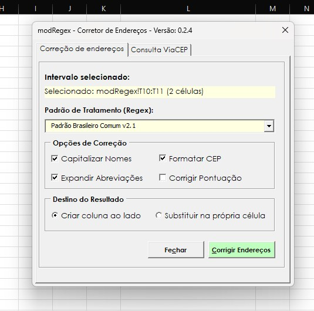
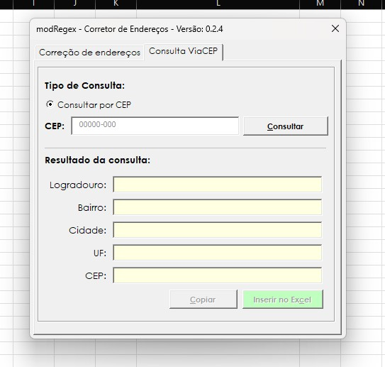

# modRegex

**Corretor de endereços para Microsoft Excel, desenvolvido em VBA.**

O modRegex é um suplemento (`.xlam`) para quem precisa corrigir, padronizar e consultar endereços sem sair do Excel. A ferramenta trabalha diretamente com as células selecionadas e oferece consulta de endereços pelo CEP, utilizando o [ViaCEP](https://viacep.com.br/).

### Download

**[Baixar a versão mais recente do modRegex](https://github.com/VBAdev2/modRegex/releases/latest)**

O arquivo `modRegex.xlam` está disponível na seção **Assets** da Release. Consulte as instruções de instalação abaixo.

## Funcionalidades

- **Correção de endereços:** tratamento de textos com expressões regulares (Regex).
- **Padronização:** ajustes de letras maiúsculas e minúsculas, abreviações, pontuação e formato do CEP.
- **Seleção de células:** o formulário acompanha o intervalo selecionado no Excel.
- **Destino do resultado:** opção de gravar em outra coluna ou substituir o conteúdo original.
- **Consulta de CEP:** pesquisa no ViaCEP, com possibilidade de copiar o endereço retornado ou inseri-lo na planilha.
- **Abertura sob demanda:** o formulário abre apenas ao acionar a macro na Faixa de Opções.

> A consulta disponível nesta versão é **por CEP**.

## Capturas de tela

### Correção de endereços

### Consulta ViaCEP

## Requisitos

- Microsoft Excel Desktop para **Windows**, com suporte a VBA.
- Permissão para executar suplementos com macros.
- Conexão com a internet **somente para a consulta ViaCEP**.

## Instalação

1. Acesse a página de [Releases](https://github.com/VBAdev2/modRegex/releases/latest) e baixe o arquivo `modRegex.xlam`.
2. Recomenda-se salvar o suplemento na pasta padrão de suplementos do Excel:

   `C:\Users\SEU_USUARIO\AppData\Roaming\Microsoft\AddIns`

   **Acesso rápido:** pressione `Win + R`, digite `%APPDATA%\Microsoft\AddIns` e pressione Enter.

3. Mova o arquivo `modRegex.xlam` para essa pasta.
4. Se o Windows tiver bloqueado o arquivo baixado e você confiar na origem, clique com o botão direito nele, acesse **Propriedades** e, se disponível, marque **Desbloquear**.
5. Abra o Excel e acesse **Arquivo > Opções > Suplementos**.
6. Em **Gerenciar: Suplementos do Excel**, clique em **Ir... > Procurar...**.
7. Localize o `modRegex.xlam`, selecione-o e habilite o suplemento.
8. Acesse **Arquivo > Opções > Personalizar Faixa de Opções**.
9. Crie um grupo personalizado e adicione a macro `AbrirFormulario`, disponível na categoria **Macros**.
10. Clique no botão criado para abrir o corretor.

**Observações:**
- A pasta indicada é recomendada, mas não obrigatória.
- Mantenha o arquivo `.xlam` no mesmo local após instalá-lo.
- O formulário abre somente quando acionado pelo usuário.
- Caso as políticas da organização bloqueiem macros, consulte o administrador responsável. Não é necessário desativar globalmente a segurança do Excel.

## Como usar

### Corrigir endereços

1. Abra uma planilha e selecione as células com os endereços.
2. Abra o **modRegex** pelo botão criado na Faixa de Opções.
3. Na guia **Correção de endereços**, escolha o padrão e as opções de tratamento.
4. Escolha se o resultado será gravado na coluna ao lado ou no intervalo original.
5. Clique em **Corrigir Endereços** e confira os resultados.

**Atenção:** antes de substituir dados originais, faça uma cópia da planilha e confira o destino da gravação.

### Consultar um CEP

1. Abra a guia **Consulta ViaCEP**.
2. Digite os oito números do CEP; o campo aplica a máscara `00000-000` automaticamente.
3. Clique em **Consultar**.
4. Confira logradouro, bairro, cidade, UF e CEP retornados.
5. Use **Copiar** ou **Inserir no Excel**, conforme necessário.

A consulta depende da disponibilidade do ViaCEP. O serviço não confirma o número do imóvel nem substitui a conferência dos dados pelo usuário.

## Código-fonte

Os arquivos VBA exportados do suplemento ficam na pasta `src/`. Os formatos utilizados pelo projeto incluem:

- `.bas` — módulos de processamento e integração;
- `.cls` — classes e eventos do Excel;
- `.frm` e `.frx` — formulário e seus recursos.

## Licença

Distribuído sob a [Licença MIT](LICENSE).

Copyright (c) 2026 VBAdev2.

## Créditos

**Desenvolvimento:** [VBAdev2](https://github.com/VBAdev2)  
